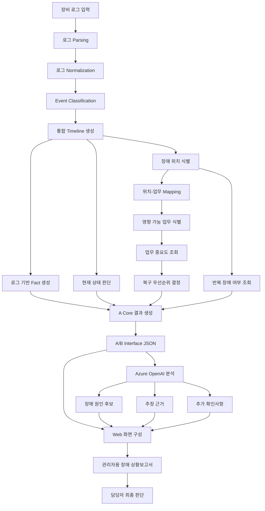
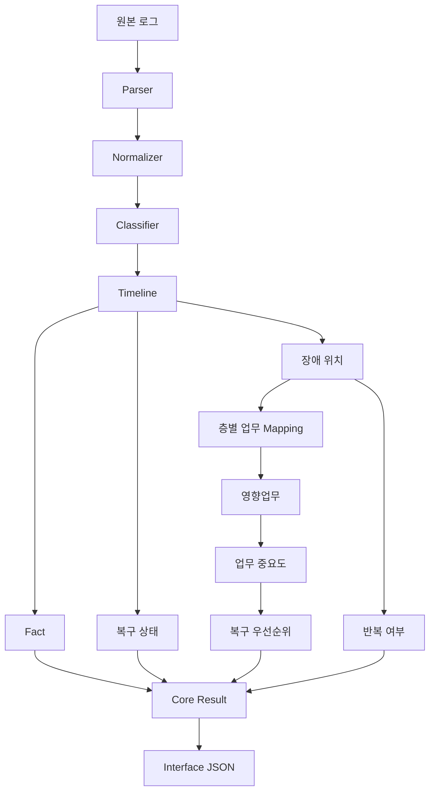
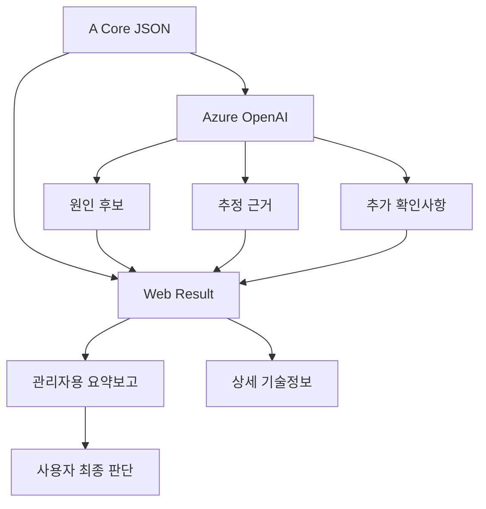
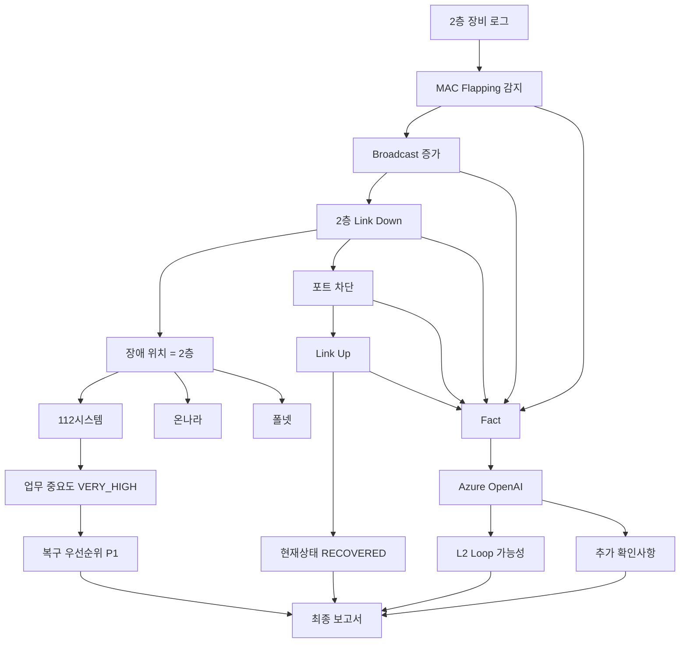

# Network Incident PoC — Processing Flow

## 1. 목적

본 문서는 네트워크 장애분석 PoC의 전체 처리 흐름을 정의한다.

전체 흐름은 다음 원칙을 따른다.

**장비 로그 → Rule 기반 사실 분석 → 업무영향·복구우선순위 판단 → AI 기반 원인 추정 → 관리자용 보고서 생성**

Rule 기반 결과와 AI 기반 추정 결과를 명확히 분리한다.

---

# 2. 전체 처리 흐름



---

# 3. A 담당 처리 흐름

A는 AI를 사용하지 않고 가능한 한 deterministic한 분석을 수행한다.



A의 최종 결과는 `interface-spec.md`에 정의된 JSON 구조를 따른다.

---

# 4. B 담당 처리 흐름

B는 A가 생성한 JSON을 입력받아 AI 분석과 사용자 화면을 담당한다.



A 구현 완료 전에도 B는 `interface-spec.md`의 Mock JSON을 사용하여 개발할 수 있다.

---

# 5. Rule 기반 처리

다음 항목은 Rule 기반으로 처리한다.

- 장애 위치
- 영향 가능 업무
- 업무 중요도
- 복구 우선순위
- 현재 네트워크 상태
- 반복 장애 여부
- Timeline
- 로그 기반 Fact

예:

```text
2층 장애
↓
112시스템 + 온나라 + 폴넷
↓
최고 중요도 = VERY_HIGH
↓
복구 우선순위 = P1
```

AI가 위 결과를 변경하지 않는다.

---

# 6. AI 기반 처리

Azure OpenAI는 다음 기능을 담당한다.

- 장애 원인 후보 추정
- 원인 후보별 근거 설명
- 로그 간 관계 해석
- 추가 확인사항 제시
- 관리자용 자연어 설명 지원

AI는 다음 내용을 확정하지 않는다.

- 실제 업무 중단 여부
- 최종 장애원인
- 업무 중요도
- 복구 우선순위

---

# 7. Fact와 Inference 분리

## Fact

로그에서 직접 확인된 내용이다.

예:

```text
MAC 주소 반복 이동 발생
Broadcast 증가
2층 연결 Down
특정 포트 차단
2층 연결 Up
```

## Inference

Fact를 기반으로 AI가 추정한 내용이다.

예:

```text
2층 내부 L2 Loop 가능성
```

최종 보고서에서도 두 정보를 혼합하지 않는다.

---

# 8. 2층 Loop Golden Sample 처리 흐름



---

# 9. 최종 보고서 생성 흐름

최종 관리자 보고서에는 다음 정보만 우선 표시한다.

```text
A Core
│
├─ 장애 위치
├─ 영향 업무
├─ 업무 중요도
├─ 복구 우선순위
├─ 현재 상태
├─ 반복 여부
└─ 핵심 장애경과

              +

B AI
│
├─ 추정원인
├─ 추정근거
└─ 추가확인

              ↓

관리자용 장애 상황보고
```

상세 로그와 기술정보는 본문이 아니라 별도 상세영역에서 제공한다.

---

# 10. 사용자 판단

본 시스템의 최종 출력은 자동 장애판정이 아니라 **판단지원 자료**이다.

최종 사용자는 다음을 종합하여 장애를 판단한다.

- 관리자용 장애 상황보고
- 상세 Timeline
- 로그 기반 Fact
- AI 추정
- 현장 상태
- 실제 업무서비스 상태

최종 장애원인은 담당자가 결정한다.

---

# 11. 장애 처리 단계 정의

전체 Incident는 다음 단계로 이해한다.

```text
정상
 ↓
이상징후
 ↓
장애발생
 ↓
업무영향
 ↓
조치
 ↓
복구
 ↓
추가확인
```

향후 실제 운영환경에서는 이 흐름을 반복 장애 분석 및 예방점검으로 확장할 수 있다.

---

# 12. PoC 범위 제한

1일 PoC에서는 다음 흐름까지만 구현한다.

```text
Sample Log
↓
Parser
↓
Normalizer
↓
Classifier
↓
Timeline
↓
장애 위치
↓
영향 업무
↓
복구 우선순위
↓
Core JSON
↓
Azure OpenAI
↓
Web
↓
관리자 보고서
```

다음 기능은 구현하지 않는다.

- 실시간 NMS 연동
- Database
- 실시간 Streaming
- 자동 장애조치
- 다중 제조사 완전 지원
- 복잡한 Topology 분석
- 반복 장애 자동학습
- 예방 장애 예측